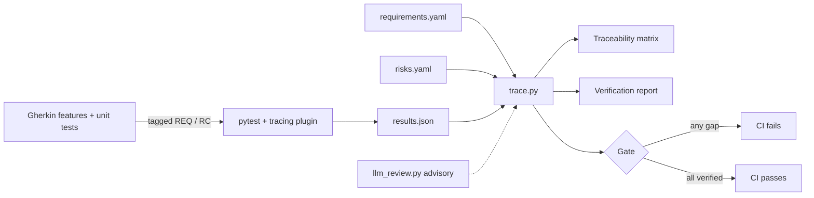

# Compliance-as-Code V&V Demo

A small synthetic pulse-rate module, verified the way IEC 62304 Class C software is expected to be. Requirements and ISO 14971 risk controls live in the repo, every test is tagged to them, and CI regenerates the traceability matrix and verification report on every push. If anything is unverified, the change is blocked.

> Demo only. The module and data are synthetic. This is not a medical device and not a real quality management system.

## What it demonstrates

- **Compliance-as-code.** `regulatory/requirements.yaml` and `regulatory/risks.yaml` are the source of truth. Tests link to them with Gherkin tags (`@REQ-002 @RC-04`) or `pytest.mark.req("REQ-002")`.
- **Automated verification evidence.** `tools/trace.py` builds the traceability matrix (Markdown and CSV) and a verification report with results, anomalies and a sign-off block.
- **Quality gate.** CI fails when a requirement or risk control is unverified, a test fails, or a test references an ID that does not exist.
- **TDD and BDD.** Gherkin feature files describe system behaviour (pytest-bdd). Unit tests cover the individual units.
- **LLM-assisted review.** An optional Claude review flags weak coverage for a human reviewer. It is advisory only.

## How evidence flows



## Run it

```bash
pip install -r requirements.txt
pytest                        # unit + BDD tests, writes reports/results.json
python tools/llm_review.py    # optional, needs ANTHROPIC_API_KEY
python tools/trace.py         # matrix, report and gate (exit code 1 on any gap)
```

Or run `make verify`. The evidence lands in `reports/`. In CI it is uploaded as a build artifact, and the verification report appears on the run's summary page.

## Gate rules

The gate blocks the change when:

- a requirement has no passing test, or any of its linked tests fails
- a risk control relies on a requirement that is not verified
- a hazard has no risk control, or references one that does not exist
- a test is tagged with a requirement or risk control that does not exist

## Why the LLM review is advisory

LLM output is not reproducible, so it cannot count as verification evidence under IEC 62304. Here it acts as an extra reviewer. It reads the requirements and the tests and flags clauses or boundaries nobody tested, such as no case exactly at an alarm limit. A human decides what to do about it.

To switch it on in CI, add an `ANTHROPIC_API_KEY` repository secret. Use `--strict` if you want "missing" verdicts to block the build.

## Adding a requirement, test-first

1. Add `REQ-009` to `requirements.yaml`. The gate fails because it is not verified.
2. Write the scenario tagged `@REQ-009`. The test fails (red).
3. Implement until it passes (green). The gate passes and the matrix updates itself.

## Design notes

- **Beat detection** uses a threshold relative to the signal's peak level, with hysteresis, so each beat gives exactly one peak. An early version counted the secondary (dicrotic) peak at low rates and read 35 bpm as about 66 bpm, which would have silenced the low-rate alarm. The low-rate alarm scenario and the 40 bpm accuracy tests now guard against it.
- **Test signals are seeded**, so every run produces identical evidence.

## Layout

```
regulatory/          requirements.yaml, risks.yaml
src/pulsesig/        filters, rate, quality, alarms
tests/features/      Gherkin scenarios
tests/step_defs/     pytest-bdd step definitions
tests/unit/          unit tests
tests/conftest.py    tag-to-marker mapping and results capture
tools/               trace.py (gate and evidence), llm_review.py (advisory)
.github/workflows/   CI pipeline
```
